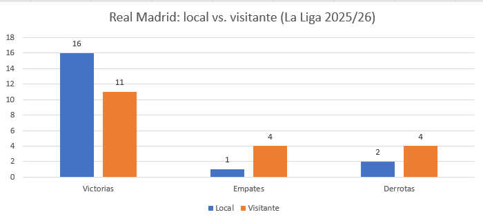
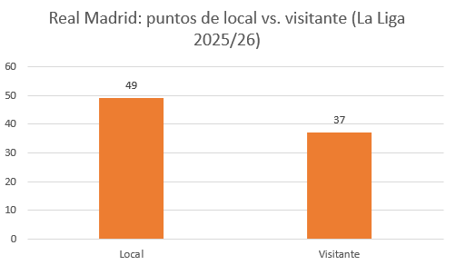
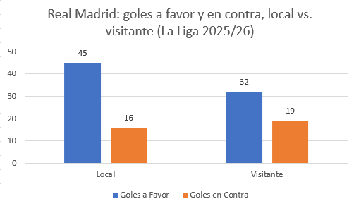

# Análisis del Real Madrid en La Liga 2025/26

Análisis del rendimiento del Real Madrid en La Liga 2025/26, comparando sus partidos de local y de visitante en resultados, puntos y goles. Se realizó en Excel con fórmulas como CONTAR.SI.CONJUNTO y SUMAR.SI, a partir de datos descargados de football-data.co.uk.

## Objetivo
Analizar el rendimiento del Real Madrid en la temporada 2025/26.

## Preguntas
1. ¿Cuántos partidos ganó, empató y perdió de local y de visitante?
2. ¿Cuántos puntos sumó en cada condición?
3. ¿Cuántos goles anotó y recibió en cada condición?
4. ¿Rinde mejor de local o de visitante?

## Datos
Fuente: football-data.co.uk, archivo SP1 de la temporada 2025/26.

## Herramientas y fórmulas
Herramienta: Microsoft Excel.
1. **CONTAR.SI.CONJUNTO:** se usó para contabilizar las victorias, empates y derrotas del Real Madrid.
2. **SUMAR.SI:** se usó para contabilizar los goles cuando fue local y cuando fue visitante.
3. **Suma de celdas:** se usó para sumar los datos de local y visitante y obtener el total.
4. **Operaciones matemáticas simples:** se usaron para calcular los puntos (3 por victoria y 1 por empate).

## Resultados

## Conclusiones

**1. ¿Cuántos partidos ganó, empató y perdió de local y de visitante?**
De local, el Real Madrid rindió muy bien: ganó 16 partidos, empató 1 y perdió solo 2. De visitante su rendimiento no fue malo, pero sí menor: ganó 11, empató 4 y perdió 4.

**2. ¿Cuántos puntos sumó en cada condición?**
Sumó 49 puntos de local y 37 de visitante.

**3. ¿Cuántos goles anotó y recibió en cada condición?**
De local anotó 45 goles y recibió solo 16. De visitante anotó 32 y recibió 19.

**4. ¿Rinde mejor de local o de visitante?**
Rinde mejor de local: obtuvo 12 puntos más y anotó 13 goles más que de visitante.

**3. ¿Cuántos goles anotó y recibió en cada condición?**
De local anotó 45 goles y recibió solo 16. De visitante anotó 32 y recibió 19.

**4. ¿Rinde mejor de local o de visitante?**
Rinde mejor de local: obtuvo 12 puntos más y anotó 13 goles más que de visitante. 
